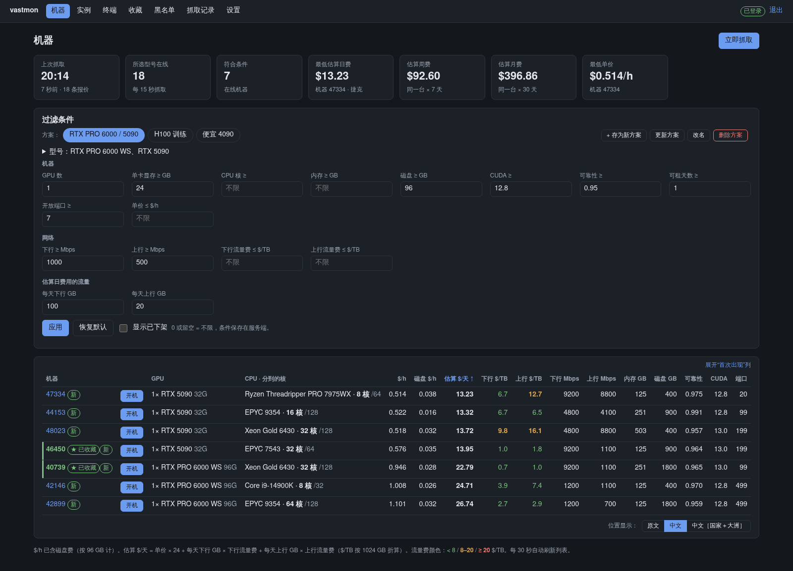
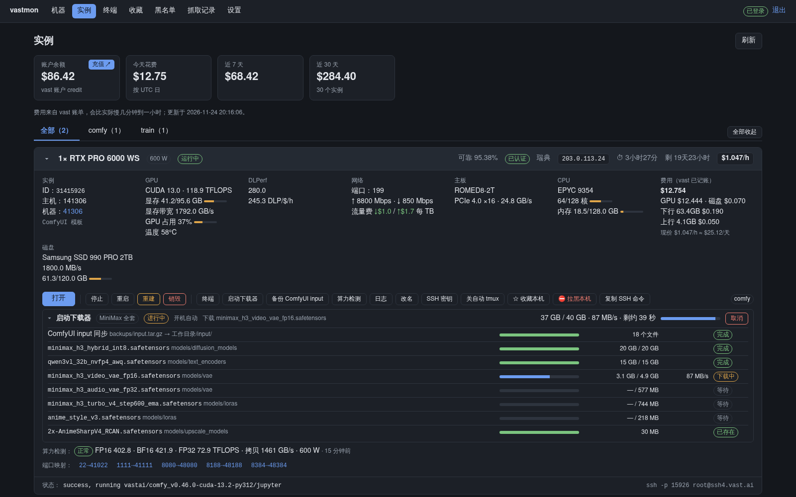
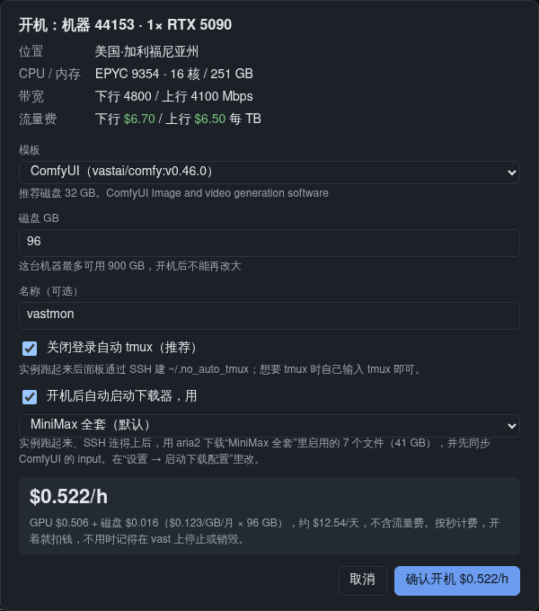
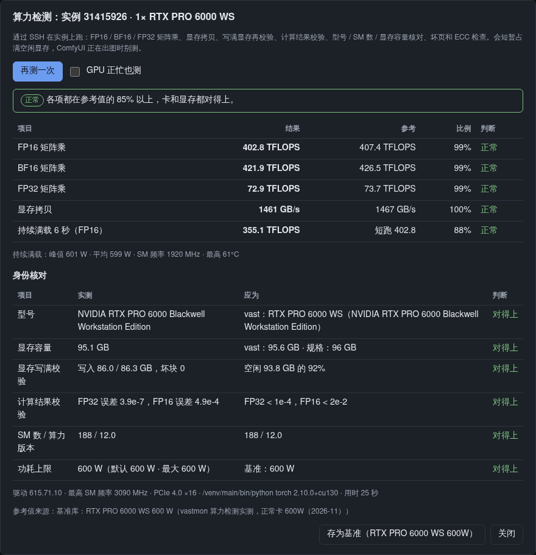
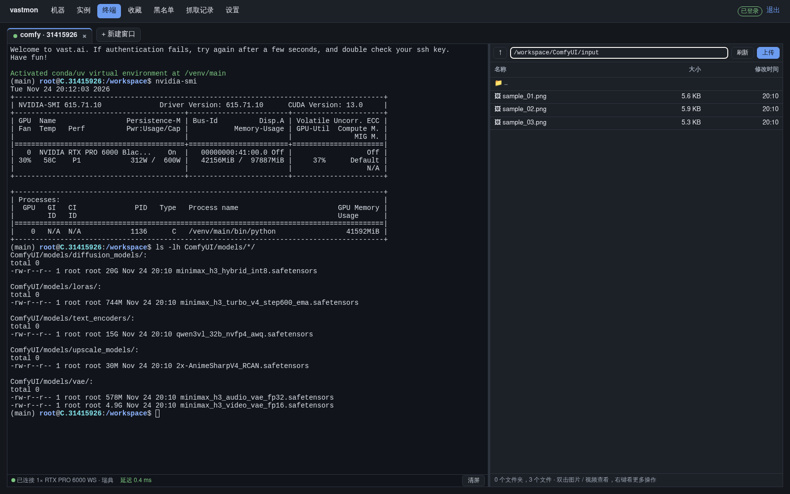
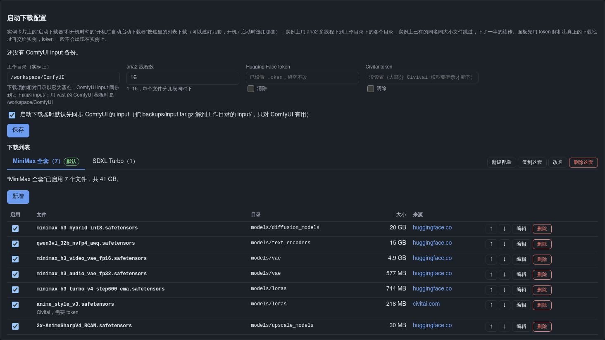

#  vastmon

**简体中文** | [English](README.en-US.md)

vastmon 是一个自托管的 [vast.ai](https://cloud.vast.ai/) 监控与开机面板。它替你盯着市场上的 GPU 报价，把流量费也算进成本里，帮你挑出真正划算的机器；开机之后，还能在同一个网页里查假卡、开终端、传文件、自动下载模型，并在实例出状况或余额告急时给浏览器发通知。

一个 Go 程序，一个 SQLite 文件，不依赖数据库服务，也不需要 Node 或 Docker。

> 面板界面目前只有中文。



---

## 为什么要做它

vast 官网的筛选器能按显卡、带宽、可靠性过滤，却**不能按流量费过滤**。同样的价格，有的机器下行流量每 TB 不到 1 美元，有的要 40 美元；下一个 30 GB 的模型，账单上可能就多出一两美元，而这在列表里完全看不出来。

vastmon 每隔两分钟抓一次报价，按你的条件过滤，并把「单价 × 24 + 每天预计流量 × 流量费」算成一个**估算日费**来排序，贵在哪里一目了然。

## 功能一览

**挑机器**
- 按型号、卡数、显存、CPU 核数、内存、磁盘、CUDA 版本、可靠性、可租天数、端口数、上下行带宽、**上下行流量费**、单价过滤
- 估算日费 / 周费 / 月费，按任意列排序；同一台机器的价格历史
- 常用的过滤条件可以存成「方案」，一点切换
- 收藏 / 黑名单（互斥），列表里标绿 / 标红，并记下原因；收藏的机器会定期检查能不能租

**开机与实例**
- 选模板、磁盘大小直接开机，开机前会按最新报价再核一次价
- 类似 vast 官网的实例卡片：状态、用量、费用、端口映射（点一下复制 `IP:端口`）
- 启动、停止、重启、重建、销毁、改名、日志、SSH 密钥管理
- 账户余额、今天 / 近 7 天 / 近 30 天花费、每个实例的 GPU / 磁盘 / 流量费用明细
- 开机后自动关掉 vast 镜像「SSH 登录就进 tmux」的行为

**查假卡**
- 一键算力检测：FP16 / BF16 / FP32 矩阵乘、显存带宽、写满显存再校验、计算结果比对、型号 / SM 数 / 显存容量核对、坏页与 ECC 检查、满载功耗与降频
- 内置性能基准数据库（各型号、各功耗档），结论分「正常 / 偏低 / 疑似假卡 / 坏卡」，可一键拉黑

**网页终端与文件**
- 多标签终端（xterm.js），显示面板到实例的 SSH 延迟，一键清屏；终端会话由面板保持：刷新页面、断网、换浏览器都能接回同一个 shell，里面跑着的程序不受影响，关掉标签才结束
- 快捷命令（底栏「命令」，像 FinalShell）：按分类存常用命令，点一下发到终端（可选只填进命令行不执行），⚙ 编辑，拖动排序或拖到别的分类；存在服务器上，所有浏览器共用，自带几条 vast / ComfyUI 常用命令（看 ComfyUI 日志、服务状态、显卡、磁盘等）
- 文件浏览器：上传、下载、删除文件、改权限、预览图片和视频；双击文本文件在弹窗里编辑，打开过的文档留在标签上随时切回；带目录树，可以放在终端右侧或下方（FinalShell 那样左树右文件），也可以收起
- 系统监控：终端左边一栏，显示运行时间、负载、CPU / 内存 / 交换、占用最高的进程、网速和 SSH 延迟曲线、磁盘空间（CPU 和内存按容器配额算，不是整台宿主机）；底部的「GPU 监控」开关再加上 nvtop 里的那些：每张卡的占用、显存、温度、功耗、风扇、曲线和卡上的进程

**启动下载器**
- 在设置里配置几套下载列表（链接 + 目标目录），支持 Hugging Face 与 Civitai（含 token）
- 实例上用 aria2 多线程下载，卡片上显示每个文件的进度和速度；已存在的跳过，中断的续传，磁盘不够的标出来
- 开机时可以勾「开机后自动启动下载器」，机器一跑起来就开始下
- 面向 ComfyUI：自动同步 `input` 目录（你上传的图片和视频），停止 / 销毁前先把它拉回本地备份

**开机脚本**
- 在设置里写几段 bash 脚本，开机后自动在实例上按顺序运行，或者在实例卡片上随时点「运行脚本」
- 程序、配置等文件存在面板自己这里，运行前自动传到实例；每个文件还有一个带随机令牌的下载链接
- token、密码放进「变量」，只存在服务器上，运行时作为环境变量交给脚本
- 实例卡片上实时显示每个脚本的输出和退出码，可以取消，超时自动停止

**浏览器通知**（需要 HTTPS）
- 实例开机、运行、停止、离线、销毁
- 启动下载器完成或失败
- 开机脚本跑完或失败
- 余额低于设定值，或按当前花费撑不过 N 小时
- 今天花费超过设定额度

## 界面预览

> 截图里的机器、实例、账单都是演示数据。

**实例**：仿 vast 官网的实例卡片，带费用明细、端口映射、启动下载器的实时进度和算力检测结论。



**开机** 与 **算力检测**：开机时选模板、磁盘，可以勾「开机后自动启动下载器」；算力检测把实测值和同型号、同功耗档的基准对比，判断真假卡。

<p align="center">
  
  &nbsp;
  
</p>

**网页终端与文件**：多标签终端，旁边是文件浏览器，可以上传下载、删除文件、改权限、在线编辑、预览图片和视频。



**启动下载配置**：几套下载列表随时切换，支持 Hugging Face 和 Civitai。



## 快速开始

需要一台带 systemd 的 Linux 服务器（x86_64 或 arm64），以及一个 vast.ai API key（[cloud.vast.ai](https://cloud.vast.ai/) → Account → API Keys）。

```bash
curl -fsSL https://raw.githubusercontent.com/kinako404/vastmon/main/install.sh | sudo bash
```

脚本会下载对应架构的程序并校验 SHA-256，创建 `vastmon` 系统用户和 systemd 服务，然后问你三件事：API key、监听地址（默认 `0.0.0.0:8090`）、面板登录密码（直接回车会随机生成一个并打印出来）。装好后打开 `http://服务器IP:8090` 登录即可。

想无人值守安装，就把答案放进环境变量：

```bash
curl -fsSL https://raw.githubusercontent.com/kinako404/vastmon/main/install.sh \
  | sudo VAST_API_KEY=你的key VASTMON_PASSWORD='至少8位的密码' VASTMON_ADDR=0.0.0.0:8090 bash
```

可以用 `VASTMON_VERSION=v0.1.0` 固定版本。

## 装好之后

1. **登录**。面板所有内容都要登录后才能看。
2. **配置 SSH 私钥**（设置 → SSH 私钥）。算力检测、网页终端、文件浏览、启动下载器都要通过 SSH 登录实例。把私钥粘贴进去即可，它只保存在服务器上；页面会显示对应的公钥，并告诉你它在不在 vast 账户里——不在的话，新开的实例默认登不上。
3. **设好过滤条件**，存成方案，然后去列表里挑机器。
4. 想要浏览器通知、或者打算长期对外使用，请**套一层 HTTPS**（见下一节），再在「设置 → 站点」里填上 HTTPS 地址。

## 用 HTTPS 访问（推荐）

面板本身只说 http。浏览器只在 HTTPS 下允许网页通知，而且面板里有能开机花钱的功能，对外长期使用也应该加密。在前面放一个反向代理或 CDN 就行，有两点要注意：

- **放行 WebSocket**：网页终端用 `/api/term/<id>/ws`。没放行时终端会提示「面板到实例的 SSH 正常，是浏览器到面板的 WebSocket 连不上」。
- **不要缓存 `/api/`**。面板对静态文件已经发了 `Cache-Control: no-store`，升级后不会吃到旧页面。

Nginx 示例：

```nginx
server {
    listen 443 ssl http2;
    server_name vastmon.example.com;
    # ssl_certificate / ssl_certificate_key ...

    client_max_body_size 0;            # 文件浏览器上传大文件

    location / {
        proxy_pass http://127.0.0.1:8090;
        proxy_http_version 1.1;
        proxy_set_header Host $host;
        proxy_set_header Upgrade $http_upgrade;
        proxy_set_header Connection "upgrade";
        proxy_read_timeout 1d;          # 终端长连接
        proxy_buffering off;
    }
}
```

用 Cloudflare 时，确认 Network → WebSockets 是打开的。面板直接面对 Cloudflare 时，会从 `CF-Connecting-IP` 取访问者 IP（只信 Cloudflare 官方 IP 段发来的），登录失败限流按真实 IP 计算。

## 日常管理

| 做什么 | 命令 |
|---|---|
| 看状态 | `systemctl status vastmon` |
| 看日志 | `journalctl -u vastmon -f` |
| 重启 | `systemctl restart vastmon` |
| 升级到最新版 | `curl -fsSL https://raw.githubusercontent.com/kinako404/vastmon/main/install.sh \| sudo bash -s upgrade` |
| 忘了密码 | `curl -fsSL …/install.sh \| sudo bash -s passwd` |
| 卸载（保留数据） | `curl -fsSL …/install.sh \| sudo bash -s uninstall` |
| 卸载并删除数据 | `curl -fsSL …/install.sh \| sudo bash -s uninstall --purge` |

登录后也可以在「设置 → 面板密码」里改密码；改完其它设备上的登录会全部失效。

**文件位置**

| 路径 | 内容 |
|---|---|
| `/opt/vastmon/vastmon` | 程序 |
| `/etc/vastmon/vastmon.env` | 配置：API key、监听地址、额外参数（权限 600） |
| `/var/lib/vastmon/vastmon.db` | 全部数据（SQLite） |
| `/var/lib/vastmon/backups/input.tar.gz` | ComfyUI input 备份 |

**程序参数**（写在 `vastmon.env` 的 `VASTMON_ARGS` 里，改完重启）

| 参数 | 默认 | 说明 |
|---|---|---|
| `-addr` | `0.0.0.0:8090` | 监听地址（安装脚本用 `VASTMON_ADDR` 管它） |
| `-interval` | `2m` | 抓取报价的间隔 |
| `-disk` | `96` | 按多少 GB 磁盘计价，也是列表要求的最小可用磁盘 |
| `-db` | `vastmon.db` | 数据库文件 |
| `-key` | | API key 文件（默认读环境变量 `VAST_API_KEY`） |
| `-api` | `https://console.vast.ai` | vast API 地址 |

## 使用指南

### 机器列表

每行是「一台机器 + 一种卡数」：同一台 8 卡机会同时挂出 1 卡、2 卡、4 卡的报价，「GPU 数」不限时会看到同一个机器号出现好几行，这是正常的。

- **$/h** 已经包含按 `-disk` GB 计的磁盘费。
- **估算 $/天** = 单价 × 24 + 每天下行 GB × 下行流量费 + 每天上行 GB × 上行流量费。每天的预计流量在过滤条件最下面填。
- **各项最佳**（表格上方一排卡片）：在符合条件的在线机器里逐项比，每项给出第一名并和中位数对比，不合成总分——最低日费、每 $ 下载最快（下行带宽 ÷ $/h）、流量最便宜（按每天预计流量算）、最稳定（可靠性）、每 $ 功耗最高（功耗上限 × 卡数 ÷ $/h；同型号的卡被限功耗时长时间满载会慢）。并列时取估算日费低的；得奖的行在机器号后面挂标签。
- 鼠标停在 GPU 名上会显示 vast 给的算力参考值：**DLPerf**（整机通用深度学习基准分）、TFLOPS、**DLP/$/h**（= DLPerf ÷ $/h，越高越划算）。都是 vast 的估算值，不是实测。机器详情页也有。
- 流量费颜色：绿色 < 8、橙色 8–20、红色 ≥ 20（美元 / TB）。
- 最近三轮抓取里出现过的机器算在线。勾「显示已下架」可以看到消失的机器和它们最后的价格。

### 开机

点「开机」，选模板（你的模板和 vast 推荐模板，或直接填 hash_id）、磁盘大小和名称。面板会按机器号重新查一次最新报价，价格比你确认时高就不开。弹窗里还可以勾：

- **关闭登录自动 tmux**：vast 镜像默认 SSH 一登录就进 tmux，网页终端不好用；勾上后实例一跑起来就帮你关掉。
- **开机后自动启动下载器**：选一套下载配置，实例跑起来后自动下载。

### 算力检测

实例卡片上的「算力检测」会通过 SSH 在实例上跑一段 PyTorch 脚本，大约一分钟。它依次尝试 `/opt/vastmon/bin/python`、`/venv/main/bin/python` 和 `python3`，用第一个能跑 CUDA 的；所以实例镜像里要有带 CUDA 的 PyTorch（ComfyUI、PyTorch 类模板都有）。结果会和「设置 → 性能基准数据库」里同型号、同功耗档的数据比较；测得正常的结果可以「存为基准」，以后同型号的卡就拿它来比。

### 启动下载器

在「设置 → 启动下载配置」里建一套或几套列表，每一项是一个下载链接加上目标目录（相对「工作目录」，默认 `/workspace/ComfyUI`）：

- Hugging Face 的 `/blob/` 链接会自动换成 `/resolve/`，受限模型填上 HF token；
- Civitai 可以填模型页、版本下载链接或只填模型号；大多数模型要 Civitai token；
- 面板会先用 token 解析出真正的下载地址再交给实例，所以 token 一般不会出现在实例上。

实例上没有 aria2 时会自动 `apt-get install`。「ComfyUI input 同步」只对 ComfyUI 有用：开机时把 `backups/input.tar.gz` 解到工作目录的 `input/`，停止 / 重建 / 销毁前把实例上的 `input/` 拉回来合并（只增加和更新，不删除）。拉回是后台任务，进度显示在实例卡片上，备份成功后才执行操作；实例到面板的网络太慢、超过设定的时间（默认 3 分钟）还没拉完时，卡片上会问继续等、放弃备份直接执行，还是取消。设置里的「清空 input 备份」把面板上的备份清掉（旧的留一份 `input.tar.gz.prev`），之后新开的实例不再同步旧文件。

### 开机脚本

「设置 → 开机脚本」分三块：

- **脚本**：每个脚本是一段 bash，以 root 身份在工作目录里运行；勾「开机自动」的会在开机弹窗勾了「开机后自动运行脚本」时、实例一跑起来就按列表顺序运行。实例卡片上的「运行脚本」可以随时挑几个来跑。非 0 退出算失败，超过设定的分钟数（默认 30）会被停止。
- **变量**：`KEY = 值`，运行时作为环境变量交给每个脚本。适合放 token、密码；值只存在服务器上，页面只显示末 4 位。
- **文件库**：把程序、配置文件上传到面板。脚本勾上「附带」的文件，会在运行前传到实例的 `/opt/vastmon/files/`（同样的文件不重复传）。每个文件还有一个不用登录的下载链接 `https://你的站点/f/<令牌>/<文件名>`，可以在别处 `curl` 下载；令牌随时可以更换。

脚本里还能用这些变量：`VASTMON_FILES`（附带文件的目录）、`VASTMON_WORKDIR`（工作目录）、`VASTMON_INSTANCE_ID`、`VASTMON_LABEL`、`VASTMON_GPU`、`VASTMON_SITE`。

例子：把 ComfyUI 生成的图片自动转发到 Telegram（用 [filebot](https://github.com/kinako404/filebot)）——把 filebot 的二进制传进文件库，变量里填 `TG_TOKEN`、`TG_CHAT_ID`，脚本大致是：

```bash
set -euo pipefail
install -m 755 "$VASTMON_FILES/filebot-linux-amd64" /usr/local/bin/filebot
export FILEBOT_TG_TOKEN="$TG_TOKEN" FILEBOT_TG_CHAT_ID="$TG_CHAT_ID"
filebot check -d "$VASTMON_WORKDIR/output"
setsid nohup filebot run -d "$VASTMON_WORKDIR/output" > /var/log/filebot.log 2>&1 < /dev/null &
```

vast 的容器里没有 systemd；要常驻的程序可以像上面这样后台运行，镜像里有 supervisor 的话也可以写一个 `/etc/supervisor/conf.d/*.conf` 交给它管（崩了会自动拉起）。

### 浏览器通知

用 HTTPS 地址打开面板，进「设置 → 浏览器通知」，点「在这个浏览器开启通知」并允许。每个浏览器、每台设备都要单独开启一次；之后即使没开着面板也能收到。通知走浏览器厂商的推送服务：Chrome 用 Google FCM（在国内可能收不到），Edge 用微软，Firefox 用 Mozilla。

## 安全须知

- **vast API key 能开机、能花钱。** 它只保存在服务器的 `vastmon.env` 里，不会发给浏览器。
- **`vastmon.db` 很敏感**：里面有面板密码的哈希、登录会话、SSH 私钥的密码（如果设了）、HF / Civitai token、开机脚本的变量、推送用的 VAPID 私钥；文件库在数据目录的 `files/` 下。备份时请妥善保管，不要公开。
- 登录失败同一 IP 15 分钟 5 次、全局 30 次会锁 15 分钟；所有写请求都必须带 `X-Requested-With` 头，防跨站提交。
- 文件浏览器返回的文件都带 `Content-Security-Policy: sandbox`，实例上的 HTML / SVG 不能在面板的域名下运行脚本。
- 服务以独立的 `vastmon` 用户运行，systemd 加了只读系统、禁止提权等限制。

## 从源码构建

需要 Go 1.26 或更新版本，不需要 CGO（SQLite 用纯 Go 实现）。

```bash
git clone https://github.com/kinako404/vastmon.git
cd vastmon
go build -trimpath -ldflags "-s -w -X main.version=$(git describe --tags --always)" -o vastmon ./cmd/vastmon
./vastmon passwd                         # 先设面板密码
VAST_API_KEY=你的key ./vastmon            # 打开 http://服务器IP:8090
```

前端是原生 JavaScript 模块，直接嵌在程序里，不需要构建步骤。

**项目结构**

```
cmd/vastmon/          程序入口
internal/panel/       面板本体（Go）：
  panel.go              启动参数、子命令（passwd / version）
  vast.go               vast.ai API 客户端
  monitor.go filter*.go 抓取报价、过滤与方案
  rent.go instance_*.go 开机、实例操作、开机后的设置
  favorites.go blacklist.go         收藏、黑名单
  bench.go bench.py baselines*.go   算力检测与性能基准库
  term.go quickcmds.go files.go sshpool.go ssh_settings.go   网页终端、快捷命令、文件浏览、SSH
  sysmon.go             终端页的系统监控
  downloads*.go comfy_input.go input_jobs.go   启动下载器、ComfyUI input 同步与备份任务
  scripts.go            开机脚本、变量、文件库
  notify.go webpush.go billing.go   浏览器通知、账单
  auth.go store.go web.go           登录、SQLite、HTTP 路由
  web/                  前端（原生 JS，go:embed 打包）
docs/images/          README 截图
install.sh            一键安装脚本
```

## 常见问题

**终端一直「连接断开」？** 看提示：如果说「面板到实例的 SSH 正常」，是反向代理 / CDN 没放行 WebSocket；如果是 SSH 报错，检查「设置 → SSH 私钥」里的公钥在不在 vast 账户里。

**「开启通知」按钮是灰的，或者提示不允许？** 面板必须从 HTTPS 地址打开。还要检查浏览器的网站设置里有没有把通知拒绝掉。

**列表是空的？** 第一次启动后要等一轮抓取（最多两分钟），也可以点「立即抓取」。再检查过滤条件是不是太严，或者勾选的型号现在没有人出租。

## 许可

[MIT](LICENSE)。网页终端使用的 [xterm.js](https://github.com/xtermjs/xterm.js) 同为 MIT 许可，随程序一起分发，许可证见 `internal/panel/web/vendor/xterm/`。
